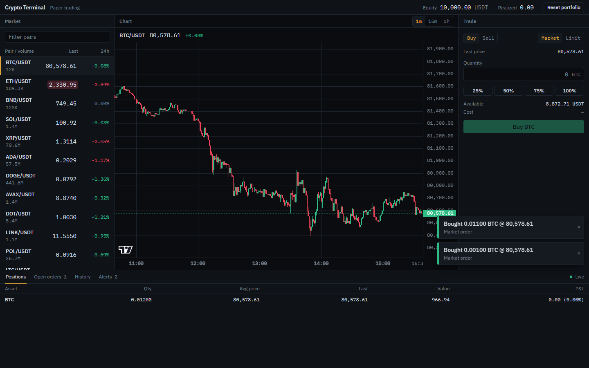

# Crypto Terminal

A paper-trading crypto terminal that runs entirely in the browser on live Binance market data.
Prices for 25 USDT pairs stream over one WebSocket, the chart loads history over REST and keeps
the last candle live, and you can place market and limit orders, set price alerts and reload the
page without losing anything. There is no backend, no account and no API key. It is a portfolio
project: the point is the state layer, where every piece of asynchronous work (the socket
lifecycle, reconnection, order matching, alerts, toasts, persistence) is a typed, tested
redux-saga.

**Live:** https://oleksiishcherbynin.github.io/crypto-terminal/



## Features

- **Live market list.** 25 USDT pairs with last price, 24h change and volume. The price cell
  flashes on each up or down tick. Client-side filter.
- **Candlestick chart** (TradingView `lightweight-charts`) for the selected pair, intervals 1m,
  15m and 1h. It loads 300 candles over REST and then follows the kline stream. If the history
  request fails, the chart says so and draws live candles only.
- **Paper trading** from a virtual 10,000 USDT balance. Market and limit orders, buy and sell,
  25/50/75/100 % quantity shortcuts that follow the live price, a limit price prefilled on the
  valid side of the market, live cost and proceeds, inline validation. Funds are reserved
  when a limit order is placed and released when it is cancelled.
- **Portfolio.** Positions with average entry price and unrealized P&L, total equity, realized
  P&L, open orders and trade history. Reset portfolio restores the starting balance.
- **Price alerts.** One-shot "above / below X" alerts that raise a toast and stay in the list as
  triggered.
- **Connection status.** Live, Reconnecting (attempt n) or Offline. Reconnects with exponential
  backoff and switches to a fallback host. While the feed is down, market orders are disabled and
  the form says why.
- **Persistence.** Balance, positions, orders, trades, alerts and the selected pair and interval
  survive a reload (`localStorage`, versioned key). Restored limit orders and alerts are watched
  again on boot.

## Stack

Vite, React 19, TypeScript (`strict`), Redux Toolkit, redux-saga, Tailwind CSS v4,
lightweight-charts, big.js for money math. Tests: Vitest, redux-saga-test-plan, React Testing
Library. Lint: oxlint. Formatting: Prettier. CI/CD: GitHub Actions to GitHub Pages.

## Architecture

```
src/
  app/             store, rootSaga, supervise, persistence (load + saga), typed hooks, app shell
  features/
    market/        tickers, connection and selection slices; marketStreamSaga; market list
    chart/         candles slice; chartSaga; chart panel
    orders/        open orders slice; tradeSaga, orderWatcherSaga; trade form, open orders table
    portfolio/     balance, positions and trades slice; memoized selectors; header, tables
    alerts/        alerts slice; alertSaga; alert form and list
    notifications/ toasts slice; toastSaga, notificationsSaga; toast stack
  domain/          shared types, cross-feature actions, pair list, formatting, money math
  services/binance WebSocket client, REST client, message parsers, host list
  ui/              Button, Input, Panel, Segmented, Tabs
```

Each feature owns its slice, sagas, selectors, components and tests. Features never import each
other's reducers or call each other; they talk through actions. For example, `tradeSaga` and
`orderWatcherSaga` dispatch `orderFilled`, and the portfolio reducer, the orders reducer and
`notificationsSaga` each react to it on their own. Reducers never read other slices; anything
that needs the current price (validation, matching) is a saga that `select`s it.

Every saga gets its I/O through one injected object (`SagaDeps`: socket client, `fetchKlines`,
storage, clock, id generator, host list). Production wires the real ones in
[`main.tsx`](src/main.tsx); tests pass fakes. There are no module-level singletons to mock.

### Data flow of a price tick

```
Binance combined stream (one WebSocket, 25 miniTicker streams + 1 kline stream)
  │  services/binance/socketClient   parse raw JSON, re-subscribe every held stream on reconnect
  ▼
eventChannel with a sliding buffer   marketStreamSaga drains it every 250 ms
  │  keeps the latest tick per symbol, forwards kline candles as they arrive
  ▼
put(tickersUpdated([...]))           one action per batch, at most ~4 per second
  ├─► tickers reducer ─► selectTicker(symbol) ─► memo(MarketRow): only rows whose symbol changed re-render
  │                   └► createSelector: positions, equity ─► PositionsTable, EquityHeader
  ├─► orderWatcherSaga: one watcher per open limit order ─► put(orderFilled)
  │                       ─► portfolio + orders reducers, notificationsSaga ─► toast
  └─► alertSaga: one watcher per active alert ─► put(alertTriggered) ─► notificationsSaga ─► toast
```

## Saga patterns

[`rootSaga`](src/app/rootSaga.ts) starts every saga below under `all`, each wrapped in
`supervise`, then dispatches `appStarted`.

| Saga                                                                   | What it does                                                                                                                                                                                                                                                                                                                                                                                                                                                                                                                                                                            | Effects and patterns                                                                                                                                                                                                                             |
| ---------------------------------------------------------------------- | --------------------------------------------------------------------------------------------------------------------------------------------------------------------------------------------------------------------------------------------------------------------------------------------------------------------------------------------------------------------------------------------------------------------------------------------------------------------------------------------------------------------------------------------------------------------------------------- | ------------------------------------------------------------------------------------------------------------------------------------------------------------------------------------------------------------------------------------------------ |
| [`marketStreamSaga`](src/features/market/marketStreamSaga.ts)          | Owns the market socket. Subscribes all ticker streams, opens the connection, drains messages in 250 ms windows and dispatches one `tickersUpdated` per window. Treats close, error or 30 s of silence as a lost connection and reconnects with exponential backoff (1 s doubling to a 30 s cap), moving to the fallback host after two failed attempts. Reports Live, Reconnecting (attempt n) or Offline after five failures.                                                                                                                                                          | `eventChannel` with `buffers.sliding`, `flush`, `race` (batch tick vs. `stop`, backoff vs. `stop`), `delay`, retry loop, `call` with a `[context, method]` pair, `finally` that always closes the channel, and the socket too when `cancelled()` |
| [`chartSaga`](src/features/chart/chartSaga.ts)                         | On pair or interval change, on boot and after every reconnect: unsubscribes the stale kline stream, subscribes the new one before fetching (so no live candle is lost while history loads), fetches 300 candles. A pair or interval switch shows loading at once but waits 350 ms before touching the socket, and consecutive socket switches are held at least 520 ms apart, so even rapid clicking sends at most 4 control messages per second (Binance drops connections above 5). Each load owns an `AbortController`: a superseded load aborts its HTTP request, and every host gets an 8 s timeout. A reconnect refreshes the same chart silently instead of blanking it. | `takeLatest` with a predicate pattern plus `delay` as a debounce, `select`, `call`, `put`, `cancelled()` in `finally` to abort the superseded request                                                                                            |
| [`tradeSaga`](src/features/orders/tradeSaga.ts)                        | Validates an order request against the live price, connection status and available balance, then fills a market order at the last price or places a limit order. Routes cancel requests through a guard, so a cancel that arrives after the order already filled cannot release funds twice.                                                                                                                                                                                                                                                                                            | `takeEvery`, `select`, `put`, `all`                                                                                                                                                                                                              |
| [`orderWatcherSaga`](src/features/orders/orderWatcherSaga.ts)          | One forked watcher per open limit order, spawned on placement and re-spawned on boot for restored orders. Each waits for a live tick that crosses its limit and races that against cancellation and portfolio reset. Only ticks that arrive after the watcher starts count, so a reload can never fill an order from stale state.                                                                                                                                                                                                                                                       | `fork` per entity, `take` in a loop, `take` with a predicate, `race` (fill vs. cancel vs. reset), `select`                                                                                                                                       |
| [`alertSaga`](src/features/alerts/alertSaga.ts)                        | Validates new alerts (an alert that is already true is rejected) and runs one watcher per active alert, restored ones included. Each races the price level against deletion and reset, then dispatches `alertTriggered`.                                                                                                                                                                                                                                                                                                                                                                | `takeEvery`, `fork` per entity, `race`, `take` with a predicate, `select`, `put`                                                                                                                                                                 |
| [`toastSaga`](src/features/notifications/toastSaga.ts)                 | Dismisses each toast after 6 s unless the user closed it first.                                                                                                                                                                                                                                                                                                                                                                                                                                                                                                                         | `takeEvery`, `race` (`delay` vs. a matching dismiss action)                                                                                                                                                                                      |
| [`notificationsSaga`](src/features/notifications/notificationsSaga.ts) | Turns domain events (fills, triggered alerts, rejections) into toasts, so no reducer or component has to know about notifications.                                                                                                                                                                                                                                                                                                                                                                                                                                                      | `takeEvery` over several action types, `select`, `put`                                                                                                                                                                                           |
| [`persistenceSaga`](src/app/persistenceSaga.ts)                        | Writes the persisted slices 500 ms after the last change to any of them, and flushes synchronously on `pagehide`. Listens to the `storage` event: when another tab writes the key, it shows a "reload to sync" banner and stops writing from this tab.                                                                                                                                                                                                                                                                                                                                  | `debounce` over an action list, `select`, `call`, `eventChannel` over DOM events, `fork`                                                                                                                                                         |
| [`supervise`](src/app/supervise.ts)                                    | Wraps every root saga: if one throws, it is restarted after 1 s instead of cancelling its siblings under `all`. Gives up after five restarts to avoid a crash loop.                                                                                                                                                                                                                                                                                                                                                                                                                     | `try`/`catch` around `call`, `delay`, restart loop                                                                                                                                                                                               |

## Testing

`npm run check` runs oxlint, the TypeScript build and the full test suite: 274 tests in 49 files.

- **Sagas** (75 tests): `redux-saga-test-plan` `expectSaga` runs with the socket client, REST
  client and storage provided as fakes. They cover backoff and host switching, silence timeouts,
  cancellation cleanup, `takeLatest` superseding a fetch, debounced chart switches, aborted
  superseded requests, fill vs. cancel races, restored watchers and debounced writes.
- **Components** (74 tests): React Testing Library for the trade and alert forms (prefills,
  percent shortcuts that follow the price, validation), market row flash, the chart's price
  format, toasts, tables, tabs and the multi-tab banner. Plus an integration test
  ([`App.integration.test.tsx`](src/App.integration.test.tsx)) that renders `<App/>` on the real
  store with every saga running, drives a fake socket and checks that a streamed price, a market
  buy, a toast and a cancelled limit order all come out right.
- **Units** (125 tests): reducers, memoized selectors, order and alert validation, input parsing,
  P&L display, money math (no dust, no negative balances), Binance message parsing, kline fetch
  fallback, timeouts and cancellation, host selection, and the socket client against a fake
  `WebSocket`.

## Run locally

Requires Node 24 and npm 11.

```sh
npm ci
npm run dev       # http://localhost:5173/crypto-terminal/
npm run check     # lint (oxlint) + typecheck + tests
npm run build     # production build into dist/
npm run preview   # serve dist/ at http://localhost:4173/crypto-terminal/
```

## Limitations

- **Paper trading only.** Virtual balance, no exchange account, no real orders.
- **No fees, no slippage.** Market orders fill at the last streamed price, limit orders at their
  limit price. Long only: you can sell what you hold, not more.
- **Market orders need a live feed.** While reconnecting or offline the button is disabled.
  Limit orders and alerts can still be placed; offline, their price checks use the last known
  price (the form labels it as the last known price) and they are matched once live ticks resume.
- **Binance availability depends on the region.** Some countries and networks block Binance
  hosts. The app then shows Offline and keeps retrying; there is no second exchange.
- **One tab at a time.** Each tab runs its own watchers. When another tab changes the saved
  state, this tab shows a "reload to sync" banner and stops saving until you reload.
- **Alerts are level checks, not crossings.** An alert whose level was passed while the tab was
  closed fires on the first live tick after the next load.
- **Quiet pairs start empty.** A pair shows `--` until Binance sends its first mini-ticker, which
  for low-volume pairs can take a few seconds.
- **Desktop first.** Designed for windows 1280 px and wider; narrower screens stack the panels.

## Deploy (for the repository owner)

The workflow in [`.github/workflows/deploy.yml`](.github/workflows/deploy.yml) runs on every push
to `main`: `npm ci`, `npm run check`, `npm run build`, then publishes `dist/` to GitHub Pages.
Vite's `base` is `/crypto-terminal/`, so the repository must have that name.

1. On GitHub, create an empty repository `OleksiiShcherbynin/crypto-terminal` (no README,
   licence or `.gitignore`).
2. Push `main`:
   ```sh
   git remote add origin https://github.com/OleksiiShcherbynin/crypto-terminal.git
   git push -u origin main
   ```
3. In the repository, open **Settings → Pages** and set **Source** to **GitHub Actions**. If the
   first workflow run failed at the deploy step because Pages was not enabled yet, re-run it from
   the **Actions** tab.

The site is then live at https://oleksiishcherbynin.github.io/crypto-terminal/.
